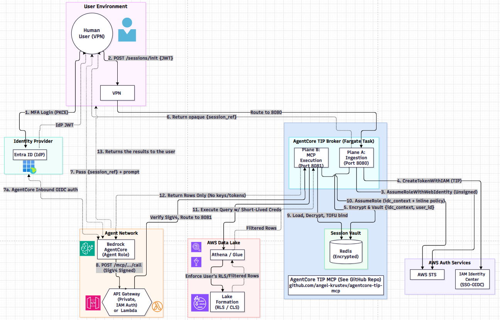

# AgentCore-TIP-MCP-Broker

A Zero-Trust Model Context Protocol (MCP) Broker bridging Amazon Bedrock AgentCore to AWS Lake Formation using Trusted Identity Propagation (TIP).

AgentCore-TIP-MCP-Broker is a deterministic policy enforcement point (PEP) for carrying a user's identity from an authenticated agent session to AWS data services. It is designed to keep identity exchange, session state, and data access under explicit policy controls rather than granting an agent ambient data permissions.

## Security model

- **Private M2M path:** In the intended deployment, Plane B runs on AWS Fargate behind a **private API Gateway with IAM authorization**. AWS infrastructure verifies the signed request; the broker does not implement custom Python SigV4 or presigned-URL verification.
- **Opaque session handoff:** MCP tools accept an opaque `session_ref`, not raw IDP bearer tokens or AWS access keys. Identity ingestion and data-plane execution are separate flows.
- **Short-lived, scoped access:** The broker uses AWS STS credentials for downstream calls and applies least-privilege policy to the requested data scope.
- **Read-only SQL validation:** SQL validation is performed with `sqlglot`; only supported read-only `SELECT`/`WITH` queries should reach the data plane.
- **No model calls in the PEP:** The broker is a deterministic gateway. LLM reasoning belongs in the Bedrock AgentCore client/agent.

The private API Gateway and Fargate boundary are deployment requirements, not resources created by the IAM examples in this repository. Adapt the supplied IAM templates and deployment guidance to your AWS account and network.

## Architecture

```text
Bedrock AgentCore
    |
    | IAM-authenticated request
    v
Private API Gateway
    |
    v
Fargate PEP ( Plane B MCP execution)
    |
    | short-lived, down-scoped AWS credentials
    v
Athena + Lake Formation / Glue / S3 Access Grants
```

The identity provider token is used only in the identity-ingestion flow. After establishing the identity context, the agent-to-PEP tool handoff uses the opaque session reference. AWS-managed IAM authorization protects the private M2M ingress; do not expose the Fargate service directly.

### Example end-to-end integration flow

The following diagram illustrates the broker integrated with a claims-data application. It is an example deployment; this repository's intended M2M ingress is a private API Gateway with IAM authorization. AWS validates the signed request at the gateway before routing it to the PEP.



The diagram labels 13 flow steps, with an additional inbound-authentication step marked 7a:

1. **MFA login:** The user signs in to Entra ID with PKCE and receives an identity-provider JWT.
2. **Initialize the session:** The application posts the JWT to `/sessions/init` through the VPN load balancer.
3. **Assume the web identity:** The broker uses the identity-provider token with AWS STS `AssumeRoleWithWebIdentity` to establish the user's AWS identity.
4. **Create the TIP token:** The broker calls `CreateTokenWithIAM` to obtain the Trusted Identity Propagation token.
5. **Encrypt and vault the session context:** The broker encrypts and stores the identity-center context and user ID in the session vault.
6. **Return the opaque session reference:** The broker returns `session_ref` to the user environment; the JWT is not passed to the agent.
7. **Send the prompt to the agent:** The user environment passes `session_ref` and the prompt to the Bedrock AgentCore agent.

   **7a. Authenticate inbound to AgentCore:** AgentCore performs inbound OIDC authentication for the agent request. **Recommendation:** use a different audience for AgentCore than for PEP session initialization, even when both are for the same app.
8. **Call the MCP endpoint:** The agent sends a SigV4-signed MCP request through private API Gateway. AWS validates IAM authorization at the gateway, which routes the request to Plane B on port 8081.
9. **Load and bind the session:** Plane B loads and decrypts the session data from the encrypted Redis vault, then binds the session to the first agent role (TOFU).
10. **Assume the scoped role:** The broker assumes an AWS role using the identity-center context and inline policy.
11. **Execute the query:** The broker queries Athena/Glue using short-lived credentials. Lake Formation enforces the user's row-level security and filters.
12. **Return authorized rows:** Only filtered rows, without keys or tokens, are returned from the data layer.
13. **Return results to the user:** The results are returned to the user environment.

## Repository layout

- `agentcore_tip/` — PEP runtime, identity strategies, SQL guard, and AWS integrations.
- `agentcore-tip-client/` — optional OIDC client package.
- `iam/` — Terraform and CloudFormation IAM examples, including Project tags.
- `docs/` — architecture, integration, and deployment guidance.
- `.github/workflows/` — ARM64 ECR build/test and manual image-promotion workflows.

The IAM templates cover identity and data-plane roles; they are not a complete API Gateway, VPC, ECS/Fargate, or CloudTrail deployment.

## Requirements

- Python 3.10 or newer for local development.
- AWS account access configured for your deployment environment.
- An identity provider configured for OIDC/TIP.
- AWS services and permissions appropriate to your workload (for example, Bedrock, Athena, Lake Formation, Glue, and S3).

The container workflow builds a Linux ARM64 image with Python 3.12.

## Local development

Create and activate a virtual environment, then install the project dependencies:

```bash
python -m venv .venv
source .venv/bin/activate
python -m pip install -e .
```

The default distribution is pure Python.

On Windows, activate with `.venv\Scripts\Activate.ps1`.

Configure the required values for your environment using `.env.example` as a reference. Do not commit credentials, tokens, account-specific secrets, or populated `.env` files.

Start the PEP locally:

```bash
python -m agentcore_tip.core.pep_server
```

Run the unit tests offline:

```bash
python -m pytest
```

Unit tests should use mocks or Botocore stubs and must not require ambient AWS credentials or live identity-provider tokens.

## AWS infrastructure and deployment

1. Review the [architecture](./docs/ARCHITECTURE.md) and [deployment topologies](./docs/deployment-topologies.md).
2. Configure the OIDC provider and required IAM role inputs for your account. The Terraform and CloudFormation examples tag supported resources with `Project: AgentCore-TIP-MCP-Broker`.
3. Deploy the broker in a private network. Restrict its ingress to private API Gateway with IAM authorization, and run it as a non-root Fargate task.
4. Configure the GitHub Actions OIDC role and the repository secret `AWS_ROLE_ARN`.
5. Create the private ECR repositories, if needed, using the default AWS profile:

   ```bash
   ./scripts/setup-ecr-repos.sh
   ```

6. Push to `main` to run the ECR build/test workflow. It builds and pushes an ARM64 test image. Use the manual ECR Promote workflow only after validating the test image.

The setup script defaults to AWS CLI profile `default` and region `us-east-1`; set `AWS_PROFILE` or `AWS_REGION` to override those values. ECR images are private by default. Publishing source code publicly does not make the container image public.

## Configuration and operations

See [.env.example](./.env.example) for supported environment variables. Set only values required by your deployment and source credentials through AWS-managed identity mechanisms rather than embedding them in environment files.

The supplied ECR workflows use GitHub Actions OIDC for AWS credentials and do not require long-lived AWS keys in GitHub secrets. The AWS role must be narrowly scoped to the specific repositories and actions required by the workflow.

## License

Apache-2.0. See [LICENSE](./LICENSE).

## Enterprise Consulting & Custom Implementations

*Placeholder: add consulting contact details, service offerings, and engagement information here.*
