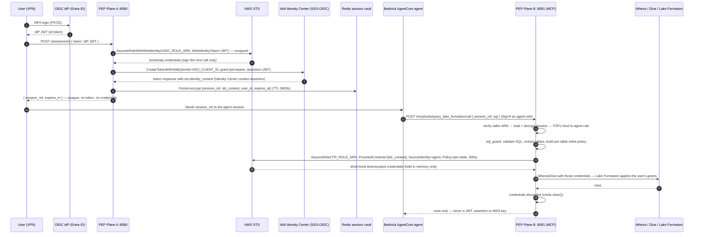

# AgentCoreTIP Secure Broker / Policy Enforcement Point (PEP) — Architecture

The PEP is a **deterministic gateway, not an agent**. It turns a human's MFA login into short-lived,
table-scoped AWS credentials for an AI agent that never holds a token, a key or an assertion — only an
opaque `session_ref`. No LLM runs inside the PEP.

Two interfaces run as two separate FastAPI apps on two ports of the same service, so the network layer can
keep humans away from the agent plane:

| Plane | Port | Routes | Reachable by |
| --- | --- | --- | --- |
| A — ingestion | `8080` (`PEP_PLANE_A_PORT`) | `/sessions/*`, `/ping` | user / VPN load balancer only |
| B — MCP execution | `8081` (`PEP_PLANE_B_PORT`) | `/mcp/*`, `/ping` | agent network only |

Each app mounts only its own router: `/mcp` does not exist on 8080 and `/sessions` does not exist on 8081.

## Flow

```
 ┌──────────────┐  1. MFA login (Entra ID, PKCE) → IDP JWT
 │ HUMAN USER   │─────────────────────────────────────────────┐
 │ (VPN)        │                                             │
 └──────▲───────┘                                             ▼
        │ 3. { session_ref }              ┌────────────────────────────────────────────────┐
        │    (opaque, nothing else)       │ VPN LOAD BALANCER  → :8080 only                │
        │                                 └───────────────────────┬────────────────────────┘
        │                                                         │ 2. POST /sessions/init { token }
 ═══════╪═════════════════════════════════════════════════════════╪══════════ PEP (one Fargate task) ═══
        │                                                         ▼
        │   PLANE A  :8080   routes: /sessions/*, /ping            (separate FastAPI app + Uvicorn server)
        │   ├ BodySizeLimitMiddleware: counts streamed bytes (≤ MAX_REQUEST_BODY_BYTES), else 413 (drained)
        │   ├ 422 handler: field location + fixed message only (JWT never echoed); refresh_token ignored
        │   ├ run_in_executor → STS AssumeRoleWithWebIdentity (unsigned, session name <base>-<uuid4>)
        │   ├ run_in_executor → SSO-OIDC CreateTokenWithIAM  → Identity Center context assertion
        │   └ session_store.create_session(idc_context, user_id) → opaque  sess_<128-bit random>
        │                                                         │
        │                                                         ▼
        │   SESSION STORE  — Redis over rediss:// (cert + hostname verified; plaintext refused at startup)
        │   ├ vt:session:<ref>  = Fernet( {ref, idc_context, user_id, created_at, expires_at} )   TTL 3600s
        │   │                     key = PEP_ENCRYPTION_KEY (MultiFernet; comma-separated for rotation)
        │   │                     tampered / swapped / wrong-key / plaintext records → "no session"
        │   └ vt:bind:<ref>     = first agent role ARN (SET NX, TTL = remaining session life)  ← TOFU
        │                                                         ▲
        │                                                         │ resolve + bind
        │   PLANE B  :8081   routes: /mcp/*, /ping                (separate FastAPI app + Uvicorn server)
        │   ├ BodySizeLimitMiddleware + 422 handler (same as Plane A)
        │   ├ caller identity: full ARN parsed (partition, service, account, role) → same account as the
        │   │   carrier role + PEP_ALLOWED_AGENT_ROLES (full role ARNs, validated at startup); else 401/403
        │   ├ session_ref valid? → TOFU: first agent role owns it, any other role rejected, no AWS call made
        │   ├ sql_guard (sqlglot==30.22.0): single SELECT/WITH, identifiers \A..\Z, information_schema blocked,
        │   │     tables extracted from the AST (CTEs, subqueries, joins) → per-table inline session policy
        │   ├ run_in_executor → STS AssumeRole(CarrierRole, ProvidedContexts=[idc_context],
        │   │     SourceIdentity=<agent role name>, Policy=<per-table + fixed workgroup>,
        │   │     RoleSessionName=<base>-<uuid4>  ← the UUID is logged as request_id for CloudTrail lookup)
        │   ├ run_in_executor → Athena/Glue with the short-lived credentials (workgroup fixed server-side)
        │   ├ credentials discarded; response = rows, or ONE generic error (AWS text stays in server logs)
        │   └ no LLM, no Bedrock, no bearer tokens, no AWS keys in any request or response
 ═══════════════════════════════════════════════════════════════════════════════════════════════════════
                                                              ▲
                                       5. POST /mcp/tools/<tool>/call { session_ref, sql }
                                          (SigV4 by the agent role; caller ARN injected by the trusted front end)
 ┌──────────────────────────────────────────────────────────┴──────────────────────────────────────┐
 │ AGENT NETWORK ONLY → :8081         BEDROCK AGENTCORE RUNTIME (microVM)                           │
 │ Role: FinancialAnalystAgentRole    LLM reasons → writes SQL. Holds only session_ref.             │
 │                                    Never sees a JWT, Identity Center assertion or AWS keys.      │
 └──────────────────────────────────────────────────────────────────────────────────────────────────┘
   6. rows → agent → answer to the user

 AUDIT TRAIL  CloudTrail: AssumeRole  sourceIdentity = agent role · roleSessionName = <base>-<uuid>
              PEP log: request_id=<uuid> user=<Identity Center id> agent=<role> query_id=<Athena id>
              Athena/Glue user-agent tag: AgentCoreTIP/mcp
```

## Token exchange, step by step

The broker performs **two separate token exchanges**. The first (Plane A) turns the user's IdP login into an
IAM Identity Center context assertion and vaults it. The second (Plane B) happens only when the agent submits
SQL: the vaulted assertion is attached to a just-in-time `sts:AssumeRole`, producing short-lived, table-scoped
AWS credentials that never leave the PEP process. The MCP execution plane is part of the PEP itself —
"how MCP gets the credentials" is an in-process call, not a network hop.

Separately, the Bedrock AgentCore Runtime enforces its own **inbound auth** on the user → agent invocation
with an Entra ID JWT issued for a **different audience** (the agent's app registration); that token is
app-level, unrelated to the Plane A TIP token, and never reaches the PEP.



### Plane A — user → OIDC → PEP → Identity Center assertion

1. **User → IdP.** The user authenticates to the OIDC IdP (Entra ID, PKCE; MFA enforced by IdP policy) and
   receives an IdP JWT. The agent never sees this token.
2. **User → PEP.** The user (or the ingestion client) posts the JWT to Plane A:
   `POST /sessions/init { "token": "<IdP JWT>" }` ([`plane_a_ingest.py`](../agentcore_tip/core/plane_a_ingest.py)).
3. **PEP → STS: bootstrap.** When `OIDC_ROLE_ARN` is configured, the PEP calls
   `sts:AssumeRoleWithWebIdentity` with the JWT as the web-identity token, using an **unsigned** STS client
   (no ambient credentials needed). The resulting temporary credentials exist only to sign the next call
   ([`sso_oidc.py`](../agentcore_tip/core/strategies/sso_oidc.py), `_session_for_exchange`).
4. **PEP → Identity Center: CreateTokenWithIAM.** With those bootstrap credentials the PEP calls SSO-OIDC
   `CreateTokenWithIAM` (`clientId = SSO_CLIENT_ID`, `grantType = urn:ietf:params:oauth:grant-type:jwt-bearer`,
   `assertion = <IdP JWT>`). This is the AWS **Trusted Identity Propagation** exchange: Identity Center maps
   the IdP user to its own user and returns a token response carrying `sts:identity_context` — the
   **Identity Center context assertion** (`_create_token_with_iam`, `_extract_identity_context`).
5. **Vault, don't forward.** The PEP keeps `{identity_context, user_id}` only. The record
   `{session_ref, idc_context, user_id, created_at, expires_at}` is Fernet-encrypted and stored in Redis with
   a TTL ([`session_store.py`](../agentcore_tip/core/session_store.py)). **No AWS credentials are created for
   the user at this point**, and the IdP JWT is discarded after the exchange.
6. **PEP → user.** The response is only `{ "session_ref": "sess_<128-bit random>", "expires_in": 3600 }`.
   The user passes this opaque reference to the agent session.

### Plane B — agent SQL → MCP → credentials from the vaulted assertion

7. **Agent → MCP.** The LLM writes SQL and the agent calls a Plane B tool:
   `POST /mcp/tools/query_lake_formation/call { session_ref, sql }`, SigV4-signed with the **agent's own IAM
   role**. The trusted front end (private API Gateway / Lambda proxy) verifies the signature and injects the
   caller ARN header; the PEP never parses a bearer token here.
8. **Authorize the caller.** Plane B parses the caller ARN, requires the carrier role's account (and the
   `PEP_ALLOWED_AGENT_ROLES` allow-list when set), then resolves `session_ref`: the encrypted record is loaded
   and decrypted, and **TOFU binding** ensures only the first agent role that used this `session_ref` may keep
   using it ([`plane_b_mcp.py`](../agentcore_tip/core/plane_b_mcp.py)).
9. **Scope from the SQL.** [`sql_guard.py`](../agentcore_tip/core/sql_guard.py) parses the SQL with `sqlglot`,
   rejects anything but a single `SELECT`/`WITH`, extracts every referenced table from the AST and generates an
   **inline STS session policy** naming only those tables, the fixed Athena workgroup and the results prefix.
10. **MCP gets the credentials — in process.** The tool handler calls `_vend_credentials`, which invokes
    `assume_downscoped_role` on the strategy: a single `sts:AssumeRole` on the carrier role (`TIP_ROLE_ARN`)
    with
    - `ProvidedContexts = [{ProviderArn: IdentityCenter, ContextAssertion: <vaulted idc_context>}]` — the
      user's identity rides into the session,
    - `SourceIdentity = <agent role name>` — the agent is pinned in CloudTrail,
    - `Policy = <per-table inline policy from step 9>` — the session can touch nothing else,
    - `DurationSeconds = 900` and `RoleSessionName = <base>-<uuid4>`, where the UUID is logged as
      `request_id` for CloudTrail correlation.
    The effective permissions are the **intersection** of the carrier role's policy, the inline session policy
    and the user's own Lake Formation grants (selected via the identity context).
11. **Execute and discard.** Athena/Glue run in an executor with those credentials; Lake Formation filters
    rows/columns by the *user's* grants, not the agent's or the PEP's. The credentials are cleared
    (`creds.clear()`) in a `finally` block before the response is built.
12. **Respond.** The agent receives rows (bounded by `max_rows` / `MAX_RESPONSE_BYTES`) or one generic error.
    At no point does the agent, the MCP transport or the response carry a JWT, an Identity Center assertion or
    an AWS key — the only credential-shaped thing the agent ever holds is the opaque `session_ref`.

## Tools (Plane B)

`GET /mcp/tools` lists them; `POST /mcp/tools/<name>/call` (or JSON-RPC `POST /mcp`) invokes them. Every tool
takes `session_ref` and nothing credential-like.

| Tool | Arguments | Notes |
| --- | --- | --- |
| `query_lake_formation` | `session_ref`, `sql`, optional `database`, `max_rows` | read-only SQL; the Athena workgroup is **not** an argument |
| `list_tables` | `session_ref`, optional `database` | Glue, table-scoped policy |
| `describe_table` | `session_ref`, `table`, optional `database` | Glue, table-scoped policy |

## Security properties and where they are enforced

| Property | Mechanism | Code |
| --- | --- | --- |
| Tokens never reach the agent | only `session_ref` crosses Plane B; Plane A returns only `session_ref` and `expires_in`; refresh tokens are never parsed or stored | [`plane_a_ingest.py`](../agentcore_tip/core/plane_a_ingest.py) |
| Humans cannot reach the agent plane | two apps, two ports; each mounts only its own router | [`pep_server.py`](../agentcore_tip/core/pep_server.py) |
| The LLM host is a separate process | [`server.py`](../agentcore_tip/server.py) mounts neither plane and never imports the session store; the PEP never imports `context.py` or its credential cache (lazy package exports) | `agentcore_tip/__init__.py`, `core/__init__.py` |
| No LLM in the PEP | no Bedrock or inference code on any PEP path; checked by a test | [`plane_b_mcp.py`](../agentcore_tip/core/plane_b_mcp.py) |
| Read-only SQL, least privilege | `sqlglot` AST guard (single `SELECT`/`WITH`), tables extracted from the AST, per-table inline STS session policy, SQL regenerated from the validated AST | [`sql_guard.py`](../agentcore_tip/core/sql_guard.py) |
| System catalogs blocked | any `information_schema` reference is refused, in every form | `sql_guard.py` |
| Injection-proof identifiers | `\A[A-Za-z0-9_-]{1,128}\Z` (a trailing newline cannot slip through); identifiers are re-validated before they enter an IAM ARN | `sql_guard.py` |
| Agent identity | full caller ARN parsed (partition, service, account, kind, role); must be in the carrier role's account and in `PEP_ALLOWED_AGENT_ROLES` (full role ARNs) when set | `plane_b_mcp.py` |
| Sessions bound to one agent | trust on first use: the first role to present a `session_ref` owns it (Redis `SET NX`, atomic across replicas); other roles are rejected before any credentials are vended | `plane_b_mcp.py`, [`session_store.py`](../agentcore_tip/core/session_store.py) |
| Dual-principal audit | `SourceIdentity` = the agent role; `ProvidedContexts` carries the user's Identity Center assertion; session name `<base>-<uuid4>` is unique per assumption and logged as `request_id` | [`sso_oidc.py`](../agentcore_tip/core/strategies/sso_oidc.py) |
| Sessions encrypted at rest | Fernet over the whole record, key from `PEP_ENCRYPTION_KEY`; the record carries its own `session_ref`, so copied, tampered, legacy-plaintext or wrong-key records are rejected | `session_store.py` |
| Transport to Redis | `REDIS_URL` must be `rediss://` with certificate and hostname verification on; plaintext and verification-disabling options are refused at startup | `session_store.py` |
| Fixed Athena workgroup | `pep_config.athena_workgroup` only; a caller-supplied `workgroup` is ignored | `plane_b_mcp.py` |
| No schema enumeration through errors | Athena/Glue failures return one generic message; the real reason and query id go to the server log only | `plane_b_mcp.py` |
| No token echo | the 422 handler returns only the field location and a fixed message, on both planes | `plane_a_ingest.py`, `pep_server.py` |
| Request size | streamed bytes are counted (chunked bodies, missing or lying `Content-Length`), 413 before the route runs, remainder drained within a bound so clients get the 413 instead of a reset | [`http_limits.py`](../agentcore_tip/core/http_limits.py) |
| Event loop never blocked | every Boto3 call and the Athena polling loop run in `run_in_executor` | `plane_a_ingest.py`, `plane_b_mcp.py` |

## Request lifecycle

1. **Login.** The user authenticates with the IdP (MFA is enforced by the IdP's policy).
2. **Ingest.** `POST /sessions/init { "token": "<IDP JWT>" }` on Plane A. The PEP calls
   `get_identity_context` (unsigned `AssumeRoleWithWebIdentity`, then `CreateTokenWithIAM`) in an executor,
   encrypts `{ref, idc_context, user_id, …}` into Redis and returns `{ "session_ref", "expires_in" }`.
3. **Agent call.** The agent invokes a Plane B tool with `session_ref` (and SQL), signing as its own IAM role.
   The trusted front end verifies the signature and injects the caller ARN header.
4. **Authorize.** The PEP validates the caller ARN, loads and decrypts the session, and enforces the session's
   agent binding.
5. **Scope.** `sql_guard` validates the SQL and builds a policy naming only the referenced tables, the fixed
   workgroup and (if configured) the Athena results prefix.
6. **Assume.** `assume_downscoped_role(identity_context, source_identity, policy)` calls `sts:AssumeRole`
   on the carrier role with the user's assertion, `SourceIdentity` = agent role and the inline policy.
7. **Execute.** Athena/Glue run in an executor with those credentials; Lake Formation applies the user's own
   grants. Credentials are discarded afterwards.
8. **Respond.** Rows (bounded by `max_rows` and `MAX_RESPONSE_BYTES`) or one generic error.

## Configuration

| Variable | Default | Purpose |
| --- | --- | --- |
| `SSO_CLIENT_ID`, `TIP_ROLE_ARN`, `OIDC_ROLE_ARN` | — | token-exchange application, carrier role, bootstrap OIDC role (an `aws-oidc-tip` config file is also read) |
| `AWS_REGION` | `us-east-1` | region |
| `PEP_PLANE_A_PORT` / `PEP_PLANE_B_PORT` | `8080` / `8081` | listeners (must differ) |
| `PEP_CALLER_ARN_HEADER` | `x-amzn-caller-arn` | header carrying the verified caller ARN |
| `PEP_ALLOWED_AGENT_ROLES` | empty | comma-separated **full IAM role ARNs**; empty = any role in the carrier role's account |
| `PEP_TRUSTED_PROXY_ROLES` | empty | comma-separated full IAM role ARNs of proxies (e.g. the Lambda in front of Plane B) trusted to forward the real agent role; the agent then becomes the STS `SourceIdentity` (see [pass-agent-identity-to-cloudtrail.md](pass-agent-identity-to-cloudtrail.md)) |
| `PEP_AGENT_ARN_HEADER` | `x-pep-agent-role-arn` | header a trusted proxy uses to forward the agent role ARN; ignored for other callers |
| `REDIS_URL` | unset | `rediss://…` only; unset = in-memory sessions (development only) |
| `PEP_ENCRYPTION_KEY` | — | Fernet key(s); **required** with Redis; `new,old` to rotate |
| `CONTEXT_TTL_SECONDS` | `3600` | session lifetime |
| `ATHENA_WORKGROUP`, `ATHENA_DATABASE`, `ATHENA_CATALOG`, `ATHENA_OUTPUT_LOCATION` | `idc-wg`, `lfdb`, `AwsDataCatalog`, unset | fixed query target |
| `ATHENA_TIMEOUT_SECONDS`, `ATHENA_POLL_SECONDS` | `90`, `1` | query limits |
| `MAX_REQUEST_BODY_BYTES`, `MAX_RESPONSE_BYTES` | 1 MiB, 5 MiB | size limits |
| `RATE_LIMIT_SESSION_INIT`, `RATE_LIMIT_TOOL_CALLS` | `30/minute`, `20/minute` | per-client rate limits |

The PEP refuses to start on an invalid allow-list entry, `REDIS_URL` that is not verified `rediss://`, or Redis
without a valid `PEP_ENCRYPTION_KEY`. Generate a key with
`python -c "from cryptography.fernet import Fernet; print(Fernet.generate_key().decode())"` and keep it in
Secrets Manager or SSM, not in the image.

Run it with `python -m agentcore_tip.core.pep_server` (the container's default command).

## What the PEP cannot enforce itself

- **Network isolation.** Keeping humans off port 8081 is a security-group / load-balancer rule.
- **Caller identity.** Plane B trusts the caller-ARN header set by the SigV4-verifying front end, so it must
  only be reachable through that front end. Setting `PEP_ALLOWED_AGENT_ROLES` limits which roles are accepted.
- **IAM trust.** The carrier role's trust policy must let the PEP task role call `sts:AssumeRole`,
  `sts:SetContext` and `sts:SetSourceIdentity`.
- **Redis network posture.** TLS and application-layer encryption protect data in transit and at rest in Redis;
  access control to the Redis endpoint remains the operator's responsibility.
- **MFA proof.** Many IdP tokens (including Entra v2 by default) carry no `amr` claim, so MFA is enforced by the
  IdP's policy rather than verified by the PEP.

## Verification

- Offline suite: `pytest tests/` — [`tests/test_pep_e2e.py`](../tests/test_pep_e2e.py); no AWS credentials or
  IdP tokens needed (Boto3 `Stubber`, `unittest.mock`, in-process fakes).
- Live end-to-end test: [`examples/mfa_pep_client.py`](../examples/mfa_pep_client.py) — browser MFA login, then
  every tool plus `--negative-checks` for the controls above. See [`examples/README.md`](../examples/README.md).
