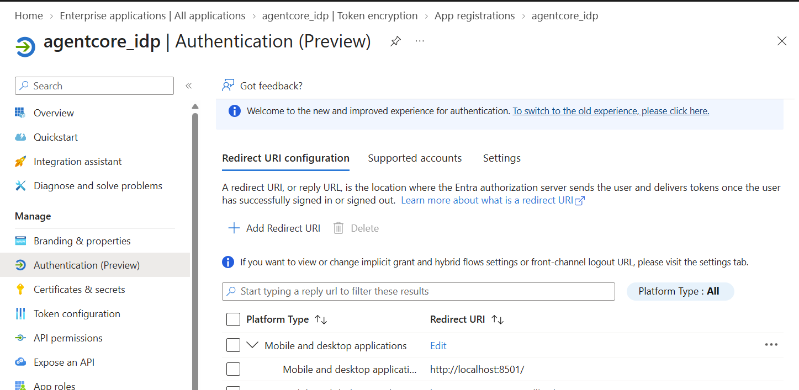
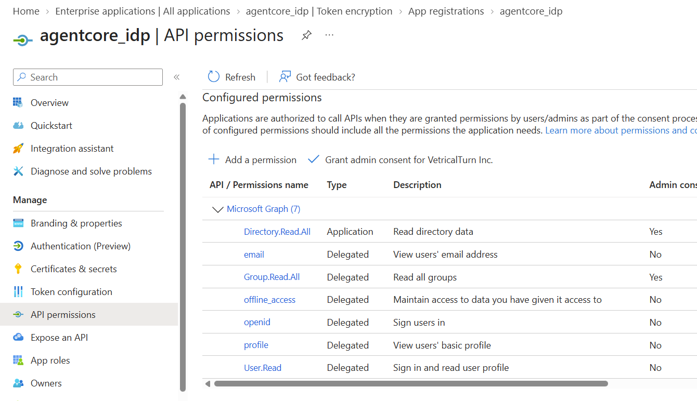
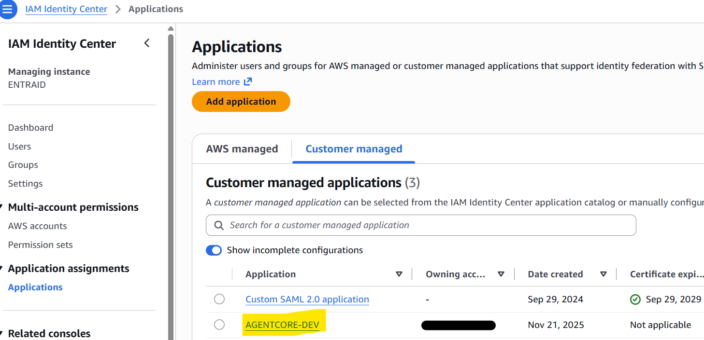
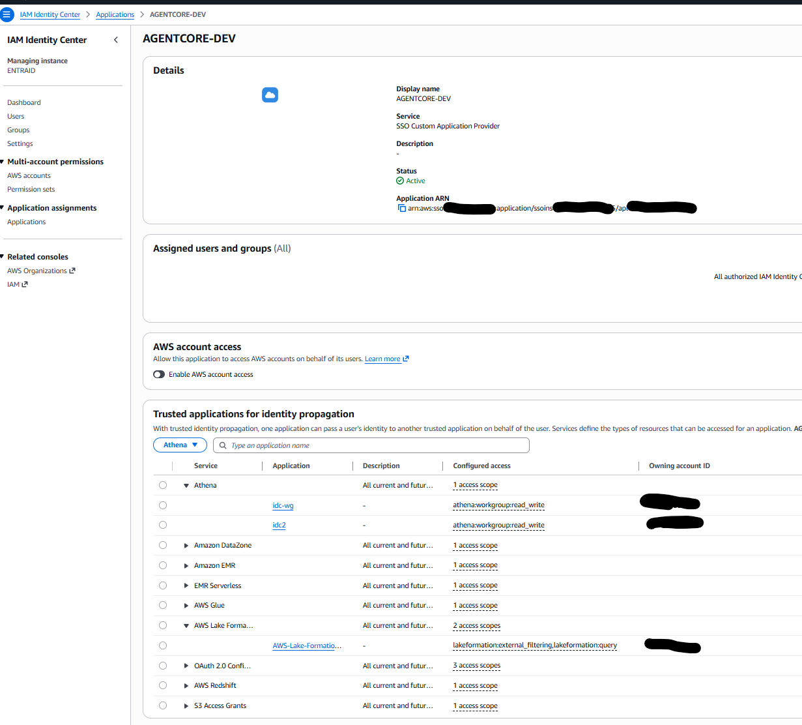
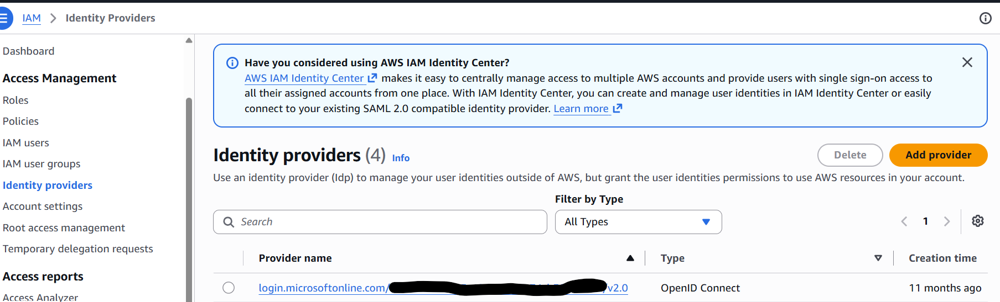

# Entra ID and AWS identity setup

This is the high-level identity prerequisite guide for the [PEP architecture](./ARCHITECTURE.md).
In this design, AgentCore inbound OIDC authentication alone does not establish downstream
Trusted Identity Propagation (TIP). The broker bridges the user's Entra ID login to IAM Identity
Center, then uses that identity to access Athena and Lake Formation.

```text
Entra ID login (MFA + PKCE)
  -> PEP Plane A: IAM OIDC federation -> Identity Center token exchange
  -> encrypted identity context + opaque session_ref
  -> PEP Plane B: identity-enhanced role -> Athena / Lake Formation
```

The agent receives only `session_ref`, never the Plane A JWT, identity context, or AWS credentials.

## Before you start

- Have administrative access to the Entra tenant, the IAM Identity Center instance, and the
  target AWS account where the broker's IAM roles and data services run.
- Enable IAM Identity Center and provision the relevant users and groups, typically through
  Entra ID SCIM synchronization. The Entra login must resolve to a corresponding Identity Center user.
- Record the Identity Center region. Configure the broker's token exchange for that region.
- Distinguish the **Identity Center administration account** from the **target application account**;
  Identity Center configuration belongs to the former, IAM OIDC providers and broker roles to the latter.

## 1. Register the Entra ID application

1. In **Microsoft Entra ID -> App registrations -> New registration**, create a single-tenant
   application for the broker's user-login flow. Record its **Directory (tenant) ID** and
   **Application (client) ID**.
2. Under **Authentication**, add a **Mobile and desktop applications** redirect URI for the
   local PKCE client. It must match the client's `OIDC_REDIRECT_URI`, including the path.
   The screenshot uses `http://localhost:8501/` (see the show case); the repository client example uses
   `http://127.0.0.1:8765/callback`. Use the one your client actually listens on.
   A public PKCE client does not need a client secret or implicit grant.
3. Under **API permissions**, configure only the delegated sign-in scopes needed for this
   ID-token flow, and request them in the client's `OIDC_SCOPES`:
   - `openid`: required to sign in and obtain an ID token.
   - `email`: needed when using the email-based Identity Center mapping described below.
     Verify that the token actually contains the claim.
   Grant consent as required by tenant policy. No Microsoft Graph directory-read or
   group-read permissions are required for this TIP flow.
4. Ensure the ID token contains the claim you will map to the Identity Center user
   (for example, `email`; configure an optional claim if needed). Enforce MFA through Entra
   Conditional Access and restrict application access to the intended users/groups.





**Production warning:** the API permissions shown in the screenshot are broader than this flow
requires. Do not copy them as a production baseline. Tighten permissions and consent according
to your enterprise's least-privilege, security, and compliance requirements; approve any
additional permissions only for separately justified application features.

For the architecture's **ID-token flow**, the token audience (`aud`) is the Entra application
client ID. The issuer (`iss`) is `https://login.microsoftonline.com/<tenant-id>/v2.0`.
Verify these values locally without uploading or logging the token.

**Keep AgentCore inbound authentication separate:** use a different app registration/audience
for user-to-AgentCore invocation, as described in the [architecture](./ARCHITECTURE.md).
That token is not the Plane A TIP token.

## 2. Configure IAM Identity Center

In the Identity Center administration account and instance region:

1. Under **Settings -> Authentication -> Trusted token issuers**, add Entra ID using
   `https://login.microsoftonline.com/<tenant-id>/v2.0`. Map the chosen token claim to a unique
   Identity Center user attribute, for example `email` to the user's email address.
2. Under **Applications -> Add application**, choose **I have an application I want to set up**
   and **OAuth 2.0**, not a custom SAML application. Give it a name such as `AGENTCORE-DEV`.
3. Attach the trusted token issuer and set its **Aud claim** to the Plane A token's audience.
   This configures the JWT-bearer token exchange. Set user/group assignments according to
   your access policy; if assignments are required, assign the intended users/groups.
4. Configure the application's IAM authentication/application policy to permit token exchange
   only by the target account's **OIDC bootstrap role**. Finalize this restriction after creating
   the role in the next section.
5. Under **Trusted applications for identity propagation**, allow the required receiving
   applications and scopes, such as the intended Athena workgroup and Lake Formation /
   AWS Glue data catalog. Prefer specific applications over granting all services.
6. Record the **Application ARN** for the broker's `SSO_CLIENT_ID`.
   This is an AWS Identity Center application ARN, **not** the Entra client ID.





## 3. Add the IAM OIDC provider in the target account

1. Open **IAM -> Identity providers -> Add provider -> OpenID Connect**.
2. Set **Provider URL** to `https://login.microsoftonline.com/<tenant-id>/v2.0`
   and **Audience** to the Plane A token's `aud`. Reuse an existing matching provider if present.
3. Create the broker roles using the [identity stack guidance](./pep-base-identity.md):
   - **OIDC bootstrap role (`OIDC_ROLE_ARN`):** trusts this provider through
     `sts:AssumeRoleWithWebIdentity`, restricts the audience, and permits
     `sso-oauth:CreateTokenWithIAM`.
   - **Carrier role (`TIP_ROLE_ARN`):** carries the user's Identity Center context and
     scoped data permissions.
   - **PEP base role:** the Fargate task role that can assume the carrier role with identity context.
4. Return to Identity Center and restrict the application policy to the new bootstrap role.



The IAM OIDC provider and Identity Center trusted token issuer are **both needed** for this
bootstrap flow. The provider audience, bootstrap role trust condition, and Identity Center
application's **Aud claim** must agree. See [OIDC provider vs. trusted token issuer](./oidc-provider-vs-trusted-token-issuer.md).

## 4. Connect and verify

- **Login client:** set `ENTRA_TENANT_ID`, `OIDC_CLIENT_ID` (Entra client ID),
  `OIDC_REDIRECT_URI`, and `OIDC_SCOPES` for the registered login flow.
- **Broker:** set `AWS_REGION`, `SSO_CLIENT_ID` (Identity Center application ARN),
  `OIDC_ROLE_ARN`, and `TIP_ROLE_ARN`; give Fargate the PEP base task role.
- Enable Identity Center on the target Athena workgroup and grant the users/groups the required
  Lake Formation permissions. Trusting an application does not itself grant data access.
- Sign in with a provisioned test user. Confirm Plane A `/sessions/init` returns only
  `session_ref` and `expires_in`, then run an authorized read through Plane B.
  Verify that a user without the relevant data grants cannot read that data.

For deployment, session-vault, and network requirements, continue with the
[architecture](./ARCHITECTURE.md) and [deployment topologies](./deployment-topologies.md).
